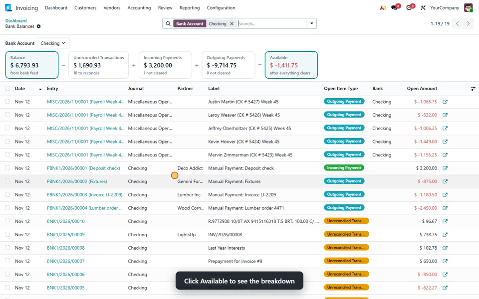

# Bank Available Balance for Odoo 19

How-to for the **NC Bank Available Balance** Odoo module: see what a checking account
will actually hold once every pending payment and bank transaction has cleared.

## Video walkthrough (1 min)

[](bank-available-balance-demo.mp4)

Click the image to open [the video](bank-available-balance-demo.mp4). The video uses Odoo demo data.

## The problem

The Accounting dashboard shows a bank **Balance** (latest bank feed balance) and
**Payments** (outstanding payments), but nothing tells you what is really available:

- Unreconciled bank transactions are already in the balance, yet the payments they settle
  still count as outstanding, so subtracting Payments from Balance counts them twice.
- Checks entered as journal entries in a Miscellaneous journal (payroll, for example) don't
  count as Payments at all.

## What the module adds

```
Available = Balance − Unreconciled transactions + Incoming payments + Outgoing payments
```

- **Default Bank on Miscellaneous journals.** Journal items posted on an Outstanding
  Receipts/Payments account get a **Bank** field, filled in from the journal's Default Bank.
- **Payments include Misc. entries.** The dashboard Payments amount adds open Misc. items
  tagged with that bank.
- **Available on the dashboard.** A new row under Payments, in red when negative.
- **Bank Balances view.** Opened by clicking Available or Payments, or from
  *Accounting ▸ Transactions ▸ Bank Balances*. Pick the bank account at the top, then click
  the bubbles to filter the list:
  - Unreconciled Transactions
  - Incoming Payments
  - Outgoing Payments

  Click Balance or Available to show everything again.

## Setup

1. Install the `nc_bank_available_balance` module.
2. Open *Accounting ▸ Configuration ▸ Journals ▸ Miscellaneous Operations* and set
   **Default Bank** on the *Journal Entries* tab. Existing open items without a bank get it too.
3. To change the bank on a single item, use the **Bank** column on the entry's Journal Items
   tab (draft entries) or in Bank Balances (posted entries).

The Default Bank field and Journal Items tab need *Show Full Accounting Features* turned on
for the user.
